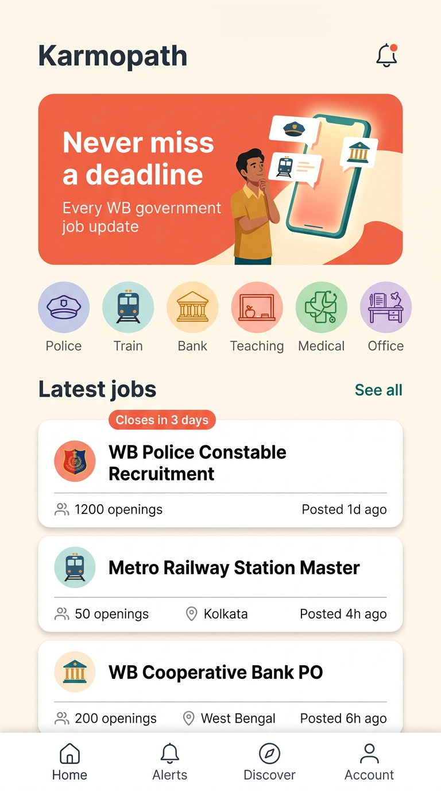

<div align="center">

# Karmopath · কর্মপথ
### কোনো ডেডলাইন আর মিস নয়।
Bengali-first job discovery & deadline tracking

**Flutter Android · Bengali + English · Independent platform**

[Product plan](docs/PRODUCT.md) · [Architecture](docs/ARCHITECTURE.md) · [Agent guide](AGENTS.md) · [Roadmap](docs/ROADMAP.md)

</div>

---

## A clearer path to your next opportunity
Karmopath is planned to turn recruitment notices into clear, searchable information: eligibility, dates, original sources and application steps—with saved opportunities and deadline reminders.

> **Current status: Batch 6 integrated; Batch 7 native integration dispatch ready.** Data/cache/preferences, feature screens and the injectable production shell exist. Three workers have separate reminder-reconciliation, Android-notification and native-factory briefs; their implementations are not yet integrated. The entrypoint still selects the foundation or isolated web demo, not a production runtime. No owner-approved production feed or native release is supplied by this dispatch.

## Approved visual direction
<p align="center"></p>

Cream, coral and teal. Custom illustrated assets. Native Bengali text in the final app.
**The image is an AI-generated concept; listings/counts are fictional. Crest-like imagery will be replaced with generic icons.**

## Planned experience
- Search and filter by qualification, district and category.
- Read structured recruitment, results and admit-card updates with original official sources.
- Save opportunities, browse a deadline calendar and opt into reminders.
- Read previously loaded information offline with clear freshness indicators.
- Owner-only local admin tool for drafting, reviewing and exporting manual posts.

| Identity | Value |
|---|---|
| App | Karmopath / কর্মপথ |
| Android package | `com.keshabstudios.karmopath` |
| Owner | Keshab Sarkar · Keshab Studios |
| Monetisation plan | AdMob, subject to policy/consent checks |

## Documentation-first development
Read [AGENTS.md](AGENTS.md) before contributing. Contracts and file ownership are frozen before parallel coding.

| Guide | Purpose |
|---|---|
| [Product](docs/PRODUCT.md) | MVP and exclusions |
| [Design](docs/DESIGN.md) | Approved direction, assets and accessibility |
| [Architecture](docs/ARCHITECTURE.md) | Data flow, public/private boundaries and costs |
| [Contracts](docs/CONTRACTS.md) | JSON schema and Dart interfaces |
| [Admin](docs/ADMIN.md) | Manual draft → review → candidate export |
| [Policy](docs/POLICY.md) | Government information, privacy, ads and release checks |
| [Acceptance](docs/ACCEPTANCE.md) | Required test evidence |
| [Roadmap](docs/ROADMAP.md) | Foundation → parallel work → integration → release |
| [Workflow guide](docs/WORKFLOWS.md) | Manual Actions and prerequisites |

### Current dispatch
[Batch 7 dispatch](docs/DISPATCH_BATCH_7.md): three independent worker briefs, frozen code base `bffcfb473d14f66bf47b85be96558497cc387dc4`, shared ports and captain-owned Android prerequisites. **Workers have not been launched by Captain.** [Paste-ready Bengali starters](docs/START_BATCH_7_BN.md) · [Verified foundation evidence](docs/reports/CAPTAIN_BATCH_7_DISPATCH.md).

### Parallel team — active Batch 7 scopes
**A:** pure reminder reconciliation · **B:** Android notification adapter · **C:** native runtime factory.
[Brief A7](docs/briefs/AGENT_A_BATCH_7.md) · [Brief B7](docs/briefs/AGENT_B_BATCH_7.md) · [Brief C7](docs/briefs/AGENT_C_BATCH_7.md) · [Frozen interfaces](docs/BATCH_7_CONTRACTS.md).

Captain owns shared files, final review/integration, lifecycle/navigation and native activation. These Batch 7 namespaces explicitly supersede historical B=features/C=admin assignments; historical Batch 1–6 briefs are complete, not current work. Use the common dispatch before branching. No worker pushes main, transfers credentials, triggers CI or publishes a feed.

## Browser design preview
[Preview setup and deployment steps](docs/WEB_PREVIEW.md). Pages is already enabled. The manual web workflow now selects an explicitly labeled, session-only demo composition of the actual screens. **The new preview is not deployed until Keshab runs the workflow.** Production integration remains pending.

## GitHub Actions
Caller workflows reuse [Keshab1997/flutter-builder](https://github.com/Keshab1997/flutter-builder) at **v1.15.0**. All are **manual only**: CI, widget diagnostics, screenshots, Android build, web preview, preview cleanup and signed release.

No workflow was dispatched during repository setup. The Flutter scaffold is present; workflow execution has not been tested. Pages is enabled; signing and Play upload are not configured. Release actions can create tags/releases—only Keshab may authorize and dispatch them.

## Public repository safety
Never commit admin drafts, tokens, service-account credentials, signing keys or applicant information. Use GitHub-hosted runners only; **do not attach an owner-PC self-hosted runner to this public repository**. Future private ingestion automation must be isolated in a separately approved private repository. No server credentials belong in the app.

## Independence & accuracy
Karmopath is an independent information platform, not affiliated with, endorsed by, or representing any government entity. Always verify eligibility and dates in the original official notice. Publication requires human source verification; AI output is not a verified notice.

**Licensing:** no open-source license has been selected. Public visibility alone does not grant a general license to reuse code/assets. Third-party font and asset licensing must be reviewed before shipping.

## Local development
Verified SDK: Flutter **3.47.7**, Dart **3.13.5**.
```sh
flutter pub get
python3 tool/preflight.py
flutter test test/contracts/job_test.dart
flutter run -d chrome
```
Preflight is structural only, not a substitute for analysis/tests. Java/Gradle compatibility and Android build are not validated locally; use the builder's configured Java runtime when the owner authorizes CI. Generated launcher icons are placeholders, not release assets.
